

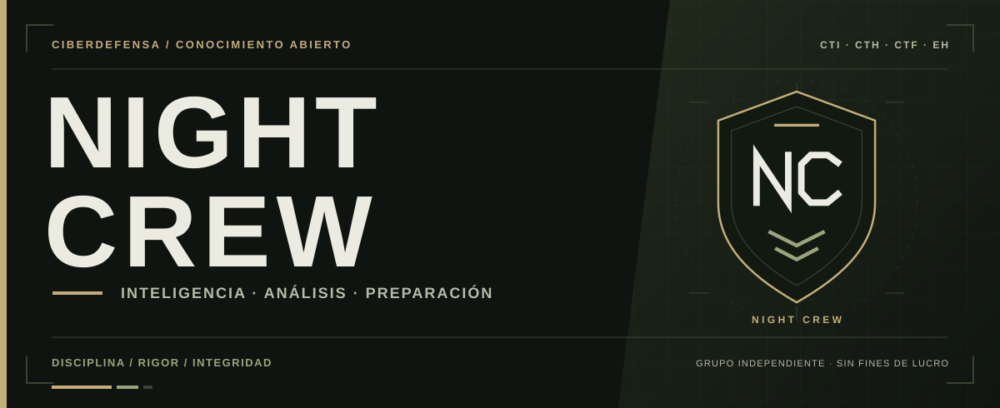

 

[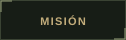](#misión)
[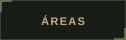](#áreas-de-conocimiento)
[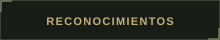](#reconocimientos)
[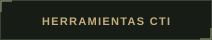](https://github.com/NIGHTCREW-CL/CTI/tree/main/tools)

 

**Inteligencia de amenazas. Preparación técnica. Evaluación autorizada.**

Desarrollo de capacidades en ciberdefensa mediante análisis de amenazas, 
preparación técnica y evaluación de seguridad.

## Misión

Desarrollar y consolidar capacidades en ciberdefensa a través del estudio de amenazas, la preparación en entornos controlados y la evaluación autorizada de seguridad. Documentar métodos y resultados con precisión, evidencia verificable y criterios de divulgación responsable.

## Principios

**Disciplina.** Preparación continua, procedimientos definidos y revisión del trabajo.

**Rigor.** Análisis trazable, validación técnica y conclusiones sustentadas en evidencia.

**Integridad.** Respeto del alcance autorizado, protección de la información y divulgación responsable.

## Áreas de conocimiento

La documentación técnica se organiza en cuatro áreas. Cada tarjeta da acceso a su repositorio.

<a href="https://github.com/NIGHTCREW-CL/CTI">
  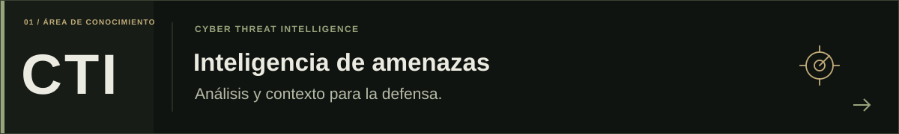
</a>

<a href="https://github.com/NIGHTCREW-CL/CTH">
  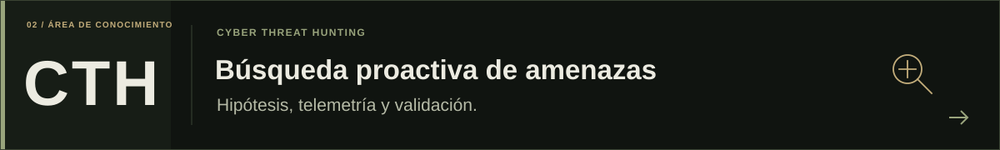
</a>

<a href="https://github.com/NIGHTCREW-CL/CTF">
  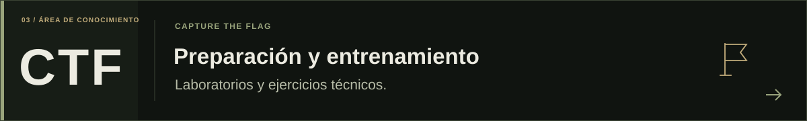
</a>

<a href="https://github.com/NIGHTCREW-CL/EH">
  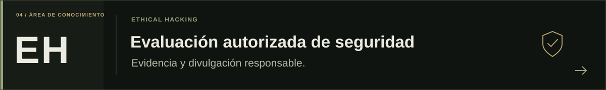
</a>

## Reconocimientos

<a href="https://llaitun.my-ctf.com/scoreboard">
  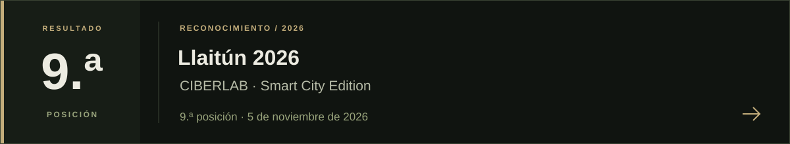
</a>

[Clasificación oficial · Llaitún 2026](https://llaitun.my-ctf.com/scoreboard)

 

<a href="https://anci.hackrocks.com/ctf/anci-ejercicio/clans">
  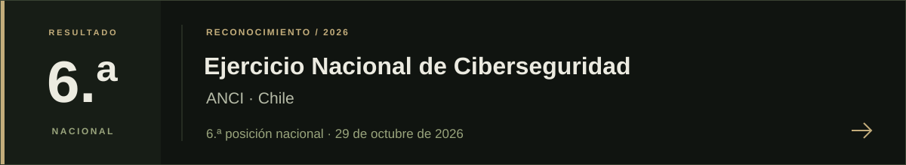
</a>

[Clasificación oficial · ANCI 2026](https://anci.hackrocks.com/ctf/anci-ejercicio/clans)

 

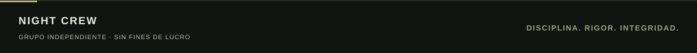
