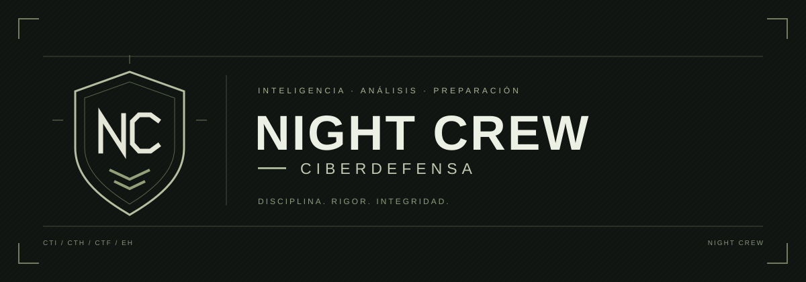
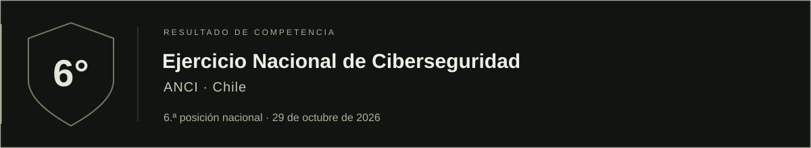

 
 

**Protección con propósito. Conocimiento que se comparte.**

Contribuimos a un entorno digital más seguro mediante la prevención, 
el desarrollo de capacidades y el acceso al conocimiento en ciberseguridad.

 

[Propósito](#propósito) &nbsp; / &nbsp; [Compromiso](#compromiso) &nbsp; / &nbsp; [Reconocimiento](#reconocimiento)

 

## Propósito

Acercar la ciberseguridad a las personas y fortalecer la confianza en el entorno digital. Orientamos nuestra labor a promover decisiones informadas, buenas prácticas y una cultura de prevención.

 

## Compromiso

| Prevención | Conocimiento abierto | Responsabilidad |
| :--- | :--- | :--- |
| Impulsar prácticas que ayuden a reducir riesgos y proteger la información. | Favorecer el aprendizaje y compartir recursos útiles para fortalecer capacidades. | Actuar con rigor, respeto por la privacidad y apego a la divulgación responsable. |

 

## Reconocimiento

Participación en el ejercicio organizado por la Agencia Nacional de Ciberseguridad de Chile. Este reconocimiento corresponde al resultado de la competencia.

 
 

---

  <strong>NIGHT CREW</strong> &nbsp; · &nbsp; Prevenir. Fortalecer. Compartir.

