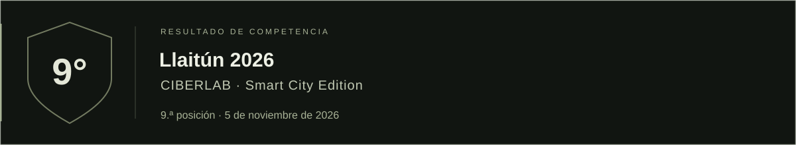

 
 

**INTELIGENCIA · ANÁLISIS · PREPARACIÓN**

Desarrollo de capacidades en ciberdefensa mediante análisis de amenazas, 
preparación técnica y evaluación de seguridad.

 

[Misión](#misión) &nbsp; / &nbsp; [Principios](#principios) &nbsp; / &nbsp; [Áreas](#áreas-de-conocimiento) &nbsp; / &nbsp; [Reconocimientos](#reconocimientos)

 

## Misión

Desarrollar y consolidar capacidades en ciberdefensa a través del estudio de amenazas, la preparación en entornos controlados y la evaluación autorizada de seguridad. Documentar métodos y resultados con precisión, evidencia verificable y criterios de divulgación responsable.

 

## Principios

| Disciplina | Rigor | Integridad |
| :--- | :--- | :--- |
| Preparación continua, procedimientos definidos y revisión del trabajo. | Análisis trazable, validación técnica y conclusiones sustentadas en evidencia. | Respeto del alcance autorizado, protección de la información y divulgación responsable. |

 

## Áreas de conocimiento

La documentación técnica se organiza en cuatro áreas:

| Área | Enfoque | Archivo |
| :--- | :--- | :--- |
| **CTI · Cyber Threat Intelligence** | Inteligencia de amenazas, análisis y contexto para la defensa. | [Consultar →](https://github.com/NIGHTCREW-CL/CTI) |
| **CTH · Cyber Threat Hunting** | Búsqueda proactiva basada en hipótesis y telemetría. | [Consultar →](https://github.com/NIGHTCREW-CL/CTH) |
| **CTF · Capture The Flag** | Formación mediante laboratorios y ejercicios técnicos. | [Consultar →](https://github.com/NIGHTCREW-CL/CTF) |
| **EH · Ethical Hacking** | Evaluación autorizada, evidencia y divulgación responsable. | [Consultar →](https://github.com/NIGHTCREW-CL/EH) |

 

## Reconocimientos

[Clasificación oficial · Llaitún 2026](https://llaitun.my-ctf.com/scoreboard)

 
 

[Clasificación oficial · ANCI 2026](https://anci.hackrocks.com/ctf/anci-ejercicio/clans)

 
 

---

  <strong>NIGHT CREW</strong> &nbsp; · &nbsp; Institución independiente, sin fines de lucro.

